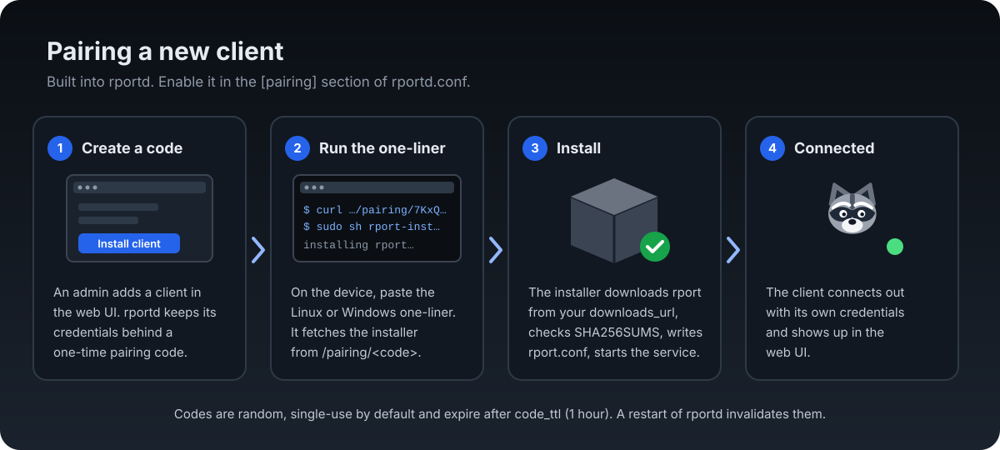


Pairing installs a client with a one-liner. You create a pairing code on the server, run the generated command on the
device, and the installer sets up `rport` with the right server address, fingerprint and credentials. The pairing
service is built into `rportd`; it's what the "Install client" dialog of the web UI uses.



## Enable pairing

Add a `[pairing]` section to `/etc/rport/rportd.conf`:

```text
[pairing]
  enabled = true
  ## Public base URL of rportd used in the one-liners. Defaults to api.base_url,
  ## and without that to the scheme and host of each request.
  url = "https://procy.example.com"
  ## Where the installer downloads the client packages from. Required.
  downloads_url = "https://procy.example.com/downloads"
  ## How long a code stays valid. Defaults to 1h.
  #code_ttl = "1h"
  ## A code is invalidated by its first successful download. Set to true to allow reuse until it expires.
  #allow_code_reuse = false
```

Restart the server with `sudo systemctl restart rportd.service`.

When pairing is enabled, `rportd` serves these routes next to the API:

| Route                 | Access               | Returns                                                           |
|-----------------------|----------------------|-------------------------------------------------------------------|
| `POST /pairing`       | API administrators   | a pairing code and the Linux and Windows one-liners               |
| `GET /pairing/<code>` | anyone with the code | the installer: PowerShell for PowerShell clients, shell otherwise |
| `GET /pairing/update` | anyone               | the client update script                                          |

The [status API](https://procy.sh/docs/api/) reports `<url>/pairing` as `pairing_url`, so the web UI finds it
without further setup. `[server] pairing_url` points the web UI at an external pairing service instead; it's ignored
while the built-in one is enabled.

## Serve the client packages

The installer doesn't download from GitHub. It expects the client packages under `downloads_url` in this layout:

```text
<downloads_url>/rport/stable/VERSION
<downloads_url>/rport/stable/SHA256SUMS
<downloads_url>/rport/stable/rport_linux_<arch>.tar.gz
<downloads_url>/rport/stable/rport_windows_x86_64.zip
```

`VERSION` holds the version number, and `SHA256SUMS` the checksums of the archives; the installer stops if a
download doesn't match. Any static web server works, for example a folder under the `doc_root` of `rportd`. Without
`downloads_url` the generated scripts refuse to run.

## Pair a client

In the web UI, open "Install client". The UI deposits the new client's credentials with `POST /pairing` and shows
the one-liners. On Linux:

```shell
curl https://procy.example.com/pairing/<code> > rport-installer.sh
sudo sh rport-installer.sh
```

On Windows, in PowerShell as Administrator:

```powershell
[Net.ServicePointManager]::SecurityProtocol = [Net.SecurityProtocolType]::Tls12
$url="https://procy.example.com/pairing/<code>"
Invoke-WebRequest -Uri $url -OutFile "rport-installer.ps1"
powershell -ExecutionPolicy Bypass -File .\rport-installer.ps1
```

The installer downloads and verifies the client, writes `rport.conf`, and installs and starts the service. The new
client then connects and appears in the web UI.

You can also create a code through the API. It needs an administrator and client credentials that the server accepts,
for example ones created with the [`/clients-auth` endpoint](/docs/get-started/client-authentication/#manage-client-credentials-via-the-api):

```shell
curl -s -u admin:$PASSWORD https://procy.example.com/pairing \
  -H "Content-Type: application/json" \
  --data-raw '{
    "connect_url": "http://procy.example.com:8080",
    "fingerprint": "<FINGERPRINT>",
    "client_id": "client7",
    "password": "<CLIENT_PASSWORD>"
  }' | jq
```

The response holds `pairing_code`, `expires` and the one-liners in `installers.linux` and `installers.windows`.

## Updating clients

`GET /pairing/update` returns the client update script: a shell script for `curl`/`wget` and PowerShell for
`Invoke-WebRequest`. Run it as root (Linux) or as an administrator (Windows), on the machine or as a remote command
from the web UI:

```shell
curl -fsS https://procy.example.com/pairing/update -o rport-update.sh && sudo sh rport-update.sh -n -m
```

```powershell
Invoke-WebRequest -UseBasicParsing https://procy.example.com/pairing/update -OutFile rport-update.ps1
powershell -ExecutionPolicy Bypass -File .\rport-update.ps1 -m
```

The update is supervised, so a failed update does not leave a machine unreachable:

1. The script downloads the latest client from `downloads_url`, verifies it against `SHA256SUMS` and backs up the
   current binary and `rport.conf`.
2. A supervisor, started detached from the client (a `systemd-run` unit on Linux, a scheduled task or WMI process
   running as SYSTEM on Windows), stops the client, installs the new version and starts it again.
3. The new client must log a connection to the server within 120 seconds and keep running for 20 more. If it does
   not, the supervisor restores the previous binary and config and restarts the client.

When the script runs as a remote command, it returns as soon as the supervisor has started; the client restarts a few
seconds later. The outcome is written to `/var/lib/rport-update/status.json` on Linux and
`C:\Program Files\rport\update\status.json` on Windows, next to an `update.log`. Windows also logs to the
Application event log (source `rport-update`). `status` is `success`, `rolled_back` or `rollback_failed`.

Use `-t` for the unstable channel. To install a specific package, pass `-z <url or file>` on Linux (`tar.gz`, `deb` or
`rpm`; set `PKG_SHA256` to verify it) or `-pkgUrl <url or file>` on Windows.


Windows versions before Windows 11 and Server 2022 cannot use TLS 1.3. Keep `tls_min` in `[api]` at its default,
`"1.2"`, if you have such clients; with `"1.3"` they cannot download the installer, the update script or the client.


## Moving clients to a new server address

Clients connect to the address in `server` in their `rport.conf`, and try `fallback_servers` when it can't be
reached. To move them to a new address, for example after a domain change, keep the old address working until every
client has moved:

1. Point the new names at the server, and list them in `[server] url` in `rportd.conf`, the one clients should use
   first. The others become the clients' fallback servers:

   ```toml
   [server]
     url = ["http://connect.example.com", "http://eu.connect.example.com"]
   ```

   Restart `rportd`. New "Install client" one-liners now use the first URL. Unspecified and loopback addresses
   (`0.0.0.0`, `127.0.0.1`, `localhost`) are never sent to clients.
2. Run the built-in library entry **Switch server** on a few test clients, then on the rest. It runs the update
   script with `-S` (Linux) or `-s` (Windows), which changes only `server` and `fallback_servers` in the `[client]`
   section and restarts the client under the same supervisor as an update: if the client does not reconnect within
   two minutes, the previous `rport.conf` is restored. The result is in the same `status.json` as an update.
3. Watch progress. Each client shows the hostname it connected with ("Connected via" on the device page,
   `connected_host` in the API):

   ```text
   GET /api/v1/clients?fields[clients]=id,name,connected_host,disconnected_at
   ```

   A client has moved when its `connected_host` is one of the new names. An empty `connected_host` means the
   client has not connected since rportd recorded it (it was offline at the upgrade): count it as not moved.
   Clients that are offline keep the name of their last connection, so they stay on the old name until they come
   back and are switched.
4. Keep the old name resolving to the server until every client shows a new name, plus a grace period for clients
   that are rarely online.

## Security notes

* A pairing code gives access to the client credentials embedded in the installer. Codes are 20 random characters,
  single-use by default and expire after `code_ttl`.
* Codes are kept in memory. Restarting `rportd` invalidates all open codes.
* Failed code lookups are rate-limited per IP address, and the responses are not cached.
* Serve `rportd`, and therefore the pairing routes, over [HTTPS](/docs/get-started/securing-rportd-with-https/).
